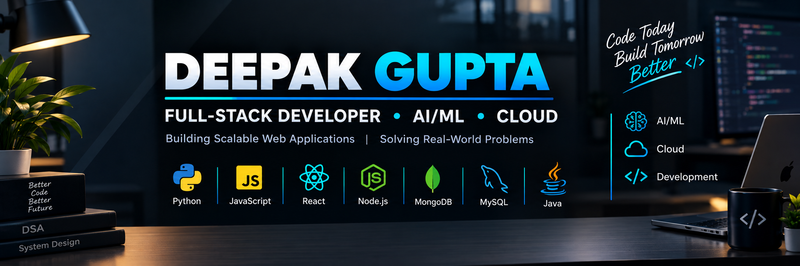

<!-- ===================== PROFILE BANNER ===================== -->

  

 

<!-- ===================== INTRODUCTION ===================== -->

<h3 align="center">
  Full-Stack Developer | AI/ML Enthusiast | BCA Computer Science Student
</h3>

  Building scalable web applications and intelligent AI solutions.

  <!-- LinkedIn -->
  

  <!-- Portfolio -->
  

  <!-- Email -->
  

  <!-- WhatsApp -->
  

  <!-- Phone -->
  

---

<!-- ===================== ABOUT ME ===================== -->

## 👨‍💻 About Me

- 🎓 Pursuing BCA in Computer Science.
- 💻 Interested in Full-Stack Web Development.
- 🤖 Building AI assistants using Python and local AI models.
- 🌱 Practicing Data Structures and Algorithms.
- 🚀 Learning to build scalable, real-world applications.
- 🎯 Goal: Become a skilled software developer and AI engineer.

---

<!-- ===================== TECH STACK ===================== -->

## 🛠️ Technologies & Tools

### 💻 Programming Languages

  

### 🌐 Frontend Development

  

### ⚙️ Backend Development

  

### 🗄️ Databases

  

### 🔧 Tools & Platforms

  

---

<!-- ===================== CURRENT FOCUS ===================== -->

## 🎯 What I'm Working On

- 🚀 Developing full-stack web applications.
- 🤖 Improving my Python-based AI assistant.
- 🧠 Strengthening Java and DSA problem-solving skills.
- 🌐 Exploring AI integration with web applications.

---

<!-- ===================== GITHUB STATISTICS ===================== -->

## 📊 GitHub Statistics

  

  

---

<!-- ===================== CONNECT ===================== -->

## 🤝 Connect With Me

  

  

---

<h3 align="center">
  💡 Code Today. Build Tomorrow. Become Better. 🚀
</h3>

  Thanks for visiting my profile! ⭐

